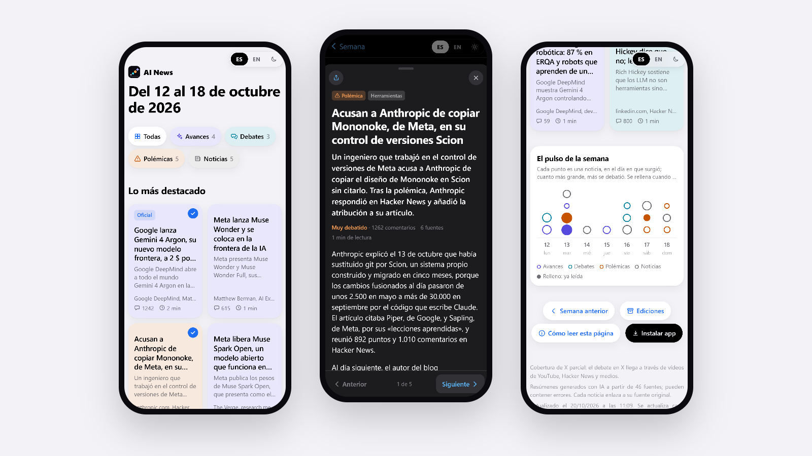

# AI News

**Live:** https://luciagasset.github.io/ai_news/

A small daily digest of what people are actually arguing about in AI. Every morning it looks at the previous
day's videos, articles, lab announcements and Hacker News threads, picks the two or three stories that generated
the most real discussion and publishes short summaries in Spanish and English. Each week (Monday to Sunday,
around 15 stories) becomes an edition you can browse later.

I built it because I wanted one place to catch up on AI without reading ten newsletters, and because it was a good
excuse to put together a complete pipeline end to end: data collection, ranking, LLM-based summarisation with
guardrails, and a front end that people would actually want to open on their phone.



## How it works

```
 YouTube transcripts ─┐
 News RSS feeds ──────┤                  ┌──────────────┐               ┌───────────┐
 AI lab blogs ────────┼──► 1. ingest ──► │ 2. group &   │ ──► 3. rank ─► │ 4. summa- │ ──► 5. render ──► GitHub Pages
 Hacker News ─────────┘                  │    classify  │               │    rise   │
                                         └──── LLM ─────┘               └─── LLM ───┘
```

The whole thing runs as a scheduled job on my laptop every morning and pushes the result to GitHub Pages.
There is no server and no paid API.

**1. Ingest.** Pulls the previous day's content from a configurable set of sources
([`config/sources.yaml`](config/sources.yaml)): YouTube channels (with their transcripts, so a 20-minute video that
covers six different topics can be split up later), RSS feeds from tech media, the news pages of OpenAI,
Anthropic and Google DeepMind, and the AI-related Hacker News stories with at least 50 points. For HN stories that
get a lot of traction but whose title says nothing about AI, it reads the linked article to decide whether it
belongs.

**2. Group and classify.** One event is usually covered by several sources, and one video usually covers several
events. An LLM reads everything collected for the day and returns structured JSON: each candidate story with
the sources that cover it, a type (*release*, *debate*, *controversy* or *news*), a category, the key entities and,
for videos, the timestamp where the topic starts. The output is validated against a `pydantic` schema before
anything else uses it. As a second check, I embed every headline with a small multilingual sentence-transformer
(`paraphrase-multilingual-MiniLM-L12-v2`, runs locally) and flag pairs with cosine similarity above 0.8 as possible
duplicates.

**3. Rank.** This part is deliberately not done by the model. Each story gets a score from:

- the number of *independent* sources (a Hacker News link counts as the outlet it points to, not as "Hacker News"),
- discussion intensity, `log(1 + points + 2·comments)`, with each source's engagement split between the stories it
  covers (a video's comments go to its main topic, not to everything it mentions in passing),
- freshness, a weight per story type (releases and controversies weigh a bit more) and a small bonus for
  priority topics and official announcements.

Selection then applies a few constraints: at most three stories a day, no type taking over the day, and a floor
relative to the day's best story, so a quiet day gets one story instead of three weak ones.

**4. Summarise.** The selected stories go back to the LLM with the source material (transcript excerpts around the
right timestamp, article text, engagement numbers). It writes a headline, a short summary and a longer one, in Spanish
with an English translation. The rules are strict and mostly about not making things up: only use the downloaded
sources, attribute every opinion, and a controversy only counts as confirmed with two independent sources or an
official one. If a video has no transcript, the story is marked as a partial summary. Output is again validated
against a schema.

**5. Render.** Each day is stored as JSON in [`history/`](history), together with its embeddings, so stories can
later be linked across weeks. Jinja templates then build a static site: the current week, an archive of past
editions, one page per story (so a shared link previews that story) and share images generated with headless
Chrome.

The LLM steps run through Claude in headless mode from the daily script: it gets a prepared markdown brief,
writes a JSON file, and has no shell or web access. Everything around them (fetching, scoring, validation, storage,
rendering) is plain Python.

## The front end

The site is a static HTML page per week with no framework. It was designed mobile-first, to be read with one hand:

- stories as cards, tinted by type, that open into a sheet with the full summary and links to every source;
- *The week's pulse*: one dot per story on the day it broke, sized by how much it was discussed;
- reading progress stored locally: a story counts as read once you scroll to the end of it;
- Spanish / English toggle, light and dark mode, and installable as a PWA that works offline.

## Running it

Requires Python 3.10+ and a free [YouTube Data API](https://console.cloud.google.com/apis/library/youtube.googleapis.com) key.

```bash
python -m venv .venv
.venv\Scripts\activate             # macOS/Linux: source .venv/bin/activate
pip install -r requirements.txt
cp .env.example .env               # add YOUTUBE_API_KEY
```

Each step can be run on its own for a given day:

```bash
python run_weekly.py ingest --date 2026-10-15    # download and prepare the day's material
python run_weekly.py select --date 2026-10-15    # score and pick the stories
python run_weekly.py render --date 2026-10-15    # store the day and rebuild the site in output/
```

`scripts/daily.py` runs the full chain for any missing days (catching up to a week if the laptop was off) and
publishes the result; `scripts/programar-tarea.ps1` schedules it with the Windows Task Scheduler.

## Project layout

```
config/sources.yaml   sources, keywords and selection limits
src/ingest/           one module per source type (YouTube, RSS, lab pages, Hacker News)
src/classify.py       prepares the LLM input and validates the grouped candidates
src/cluster.py        story clusters and duplicate detection with embeddings
src/score.py          scoring and selection
src/summarize.py      prepares the summarisation input and validates the output
src/render.py         static site, archive and per-story pages
templates/            Jinja templates for the site and the share images
history/              one JSON file per day: the dataset behind the site
```

## Known limitations

- X/Twitter isn't read directly (the API is paid); its discussions only show up through videos, HN and articles.
- Engagement is measured the next morning, so late-breaking stories may look less discussed than they end up being.
- Summaries are written by a language model and can be wrong. Every story links to its sources.

## What's next

- More sources (Reddit, arXiv, more labs).
- Linking stories across weeks (follow-up, related, contradicts) using the stored embeddings.
